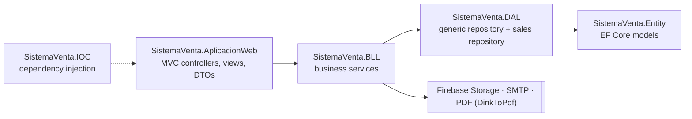

# Sistema de Ventas

**A point-of-sale and inventory web app for small businesses: products, sales, receipts, users and a live dashboard.**

## ✨ Features

- **Sales** — a fast sale screen with product search, quantities and totals, document types (receipt, invoice) and automatic correlative numbering. Every sale can be printed or downloaded as a **PDF receipt**.
- **Sales history and reports** — find sales by number or date range and export the report to Excel.
- **Dashboard** — sales and income for the last 7 days, totals of products and categories, and the best-selling products of the week, with charts.
- **Products and categories** — a catalog with stock, prices, barcodes and photos stored in **Firebase Storage**.
- **Users, roles and menus** — cookie authentication, role-based menus, and password recovery by email with HTML templates.
- **Business profile** — name, tax id, contact details, currency and logo used across the app and the receipts.

## 🏗️ Architecture

A layered solution where each project has one responsibility:

| Project | Contents |
| --- | --- |
| `SistemaVenta.AplicacionWeb` | ASP.NET Core MVC app: controllers (sales, products, categories, users, reports, dashboard, business, access), Razor views, view models and AutoMapper profiles |
| `SistemaVenta.BLL` | Services for sales, products, categories, users, roles and menus, dashboard, email, Firebase and utilities |
| `SistemaVenta.DAL` | `GenericRepository<T>` and a sales repository that registers a sale and its details in one transaction |
| `SistemaVenta.Entity` | Entity Framework Core 6 models and the database context |
| `SistemaVenta.IOC` | Registers the database context, repositories and services |

## 🚀 Getting started

**Requirements:** Windows, [.NET 6 SDK](https://dotnet.microsoft.com/download/dotnet/6.0) and SQL Server (LocalDB, Express or full).

1. Clone the repository and open `SolucionSistemaVentas.sln` in Visual Studio 2022.
2. Point `ConnectionStrings:CadenaSQL` in `SistemaVenta.AplicacionWeb/appsettings.json` to your SQL Server.
3. Create the database with the tables of `SistemaVenta.Entity` and load the initial data (roles, menus, document types, correlative numbers and the `Configuracion` rows for Firebase and email).
4. Run `SistemaVenta.AplicacionWeb`.

> Email and Firebase credentials are read from the `Configuracion` table at runtime, never from the source code.

## 📄 License

Personal project for learning and portfolio purposes.
