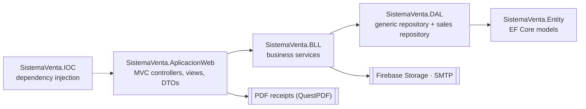

<div align="center">

# Sistema de Ventas

**A point-of-sale and inventory web app for small businesses: products, sales, receipts, users and a live dashboard.**

**[🌐 Live demo](http://sistemaventas-daniel.runasp.net)**

[](https://github.com/Daniiel18/SistemaVentas/actions/workflows/build.yml)


</div>

## ✨ Features

- **Sales** — a fast sale screen with product search, quantities and totals, document types (receipt, invoice) and automatic correlative numbering. Every sale can be printed or downloaded as a **PDF receipt** generated with QuestPDF.
- **Sales history and reports** — find sales by number or date range and export the report to Excel.
- **Dashboard** — sales and income for the last 7 days, totals of products and categories, and the best-selling products of the week, with charts.
- **Products and categories** — a catalog with stock, prices, barcodes and photos stored in **Firebase Storage**.
- **Users, roles and menus** — cookie authentication, role-based menus, and password recovery by email with HTML templates.
- **Business profile** — name, tax id, contact details, currency and logo used across the app and the receipts.

## 🏗️ Architecture

A layered solution where each project has one responsibility:



| Project | Contents |
| --- | --- |
| `SistemaVenta.AplicacionWeb` | ASP.NET Core MVC app: controllers (sales, products, categories, users, reports, dashboard, business, access), Razor views, view models, AutoMapper profiles and the PDF receipt |
| `SistemaVenta.BLL` | Services for sales, products, categories, users, roles and menus, dashboard, email, Firebase and utilities |
| `SistemaVenta.DAL` | `GenericRepository<T>` and a sales repository that registers a sale and its details in one transaction |
| `SistemaVenta.Entity` | Entity Framework Core 10 models |
| `database/` | SQL scripts: schema and initial data |
| `SistemaVenta.IOC` | Registers the database context, repositories and services |

## 🚀 Getting started

**Requirements:** the [.NET 10 SDK](https://dotnet.microsoft.com/download/dotnet/10.0) and SQL Server (LocalDB, Express, full or Azure SQL Database).

1. Create an empty database (the default connection string uses `ITventory` on LocalDB).
2. Run [`database/01_schema.sql`](database/01_schema.sql), then edit the administrator's email and password at the top of [`database/02_seed.sql`](database/02_seed.sql) and run it.
3. Point `ConnectionStrings:CadenaSQL` in `SistemaVenta.AplicacionWeb/appsettings.json` to your database, or set the `ConnectionStrings__CadenaSQL` environment variable.
4. Start the app and sign in with the administrator you created:

```bash
dotnet run --project SistemaVenta.AplicacionWeb
```

> Email and Firebase credentials are read from the `Configuracion` table at runtime, never from the source code. Fill those rows to enable password emails and photo uploads.

## ☁️ Deployment

The live demo runs on [MonsterASP.NET](https://www.monsterasp.net) (IIS, .NET 10) with its SQL Server database. The server builds the app straight from this repository with `dotnet publish`, and the production connection string lives only on the server in `appsettings.Production.json`, which is never committed.

## 📄 License

Personal project for learning and portfolio purposes.
